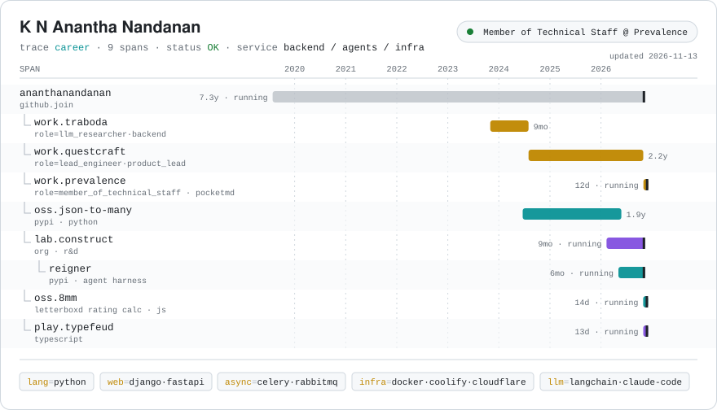
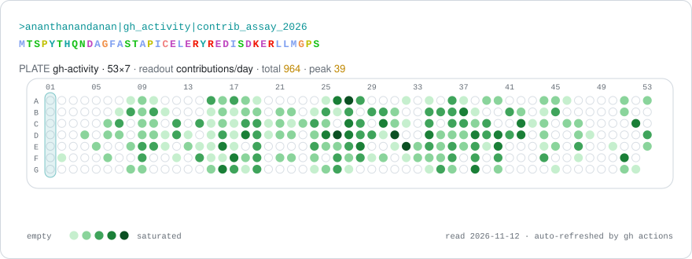

<a href="https://ananthanandanan.com">
  <picture><source media="(prefers-color-scheme: dark)" srcset="https://raw.githubusercontent.com/ananthanandanan/ananthanandanan/master/assets/trace_dark.svg"></picture>
</a>

<a href="https://ananthanandanan.com"><picture><source media="(prefers-color-scheme: dark)" srcset="https://raw.githubusercontent.com/ananthanandanan/ananthanandanan/master/assets/link_web_dark.svg"></picture></a><a href="https://www.linkedin.com/in/de-blank"><picture><source media="(prefers-color-scheme: dark)" srcset="https://raw.githubusercontent.com/ananthanandanan/ananthanandanan/master/assets/link_linkedin_dark.svg"></picture></a><a href="https://x.com/Ananthan2k"><picture><source media="(prefers-color-scheme: dark)" srcset="https://raw.githubusercontent.com/ananthanandanan/ananthanandanan/master/assets/link_x_dark.svg"></picture></a><a href="mailto:ananthanandanan@gmail.com"><picture><source media="(prefers-color-scheme: dark)" srcset="https://raw.githubusercontent.com/ananthanandanan/ananthanandanan/master/assets/link_email_dark.svg"></picture></a>

Backend engineer who ships. I build pragmatic Python systems (Django, FastAPI, Celery) and the agent harnesses that sit on top of them. Right now I'm a Member of Technical Staff at [Prevalence Health](https://www.prevalencehealth.com), building [PocketMD](https://www.pocketmd.ai), a clinical copilot for doctors. On the side I run [Construct Lab](https://github.com/Construct-Lab), where [Reigner](https://github.com/Construct-Lab/reigner) lives, build small things like [8mm](https://8mm.ananthanandanan.com), and [write](https://ananthanandanan.com) about agents, harness engineering, and self-hosting.

<picture><source media="(prefers-color-scheme: dark)" srcset="https://raw.githubusercontent.com/ananthanandanan/ananthanandanan/master/assets/plate_dark.svg"></picture>
